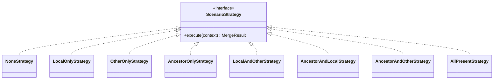
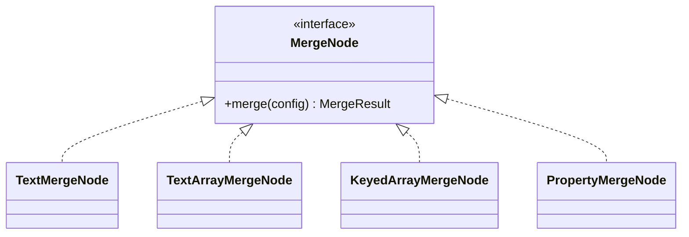
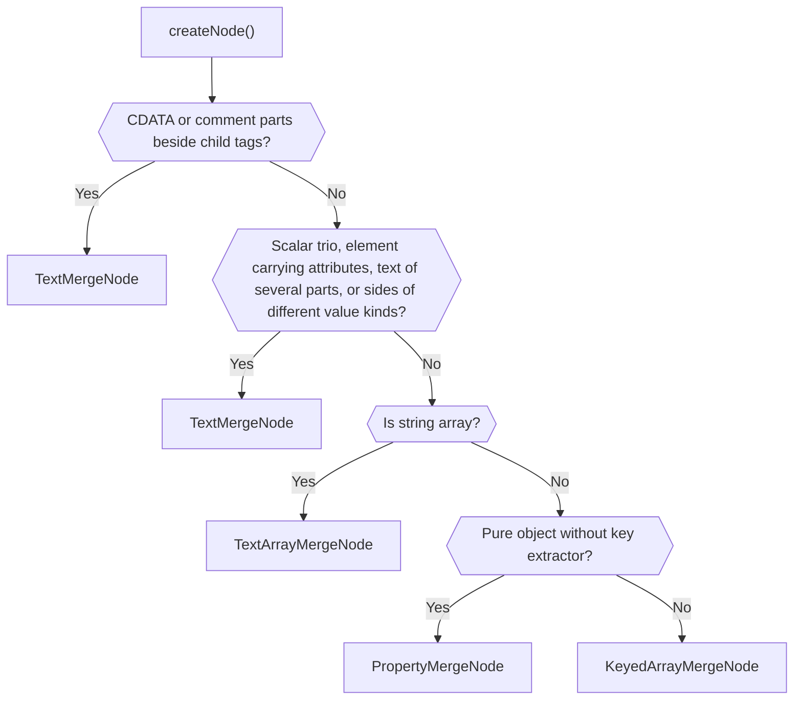
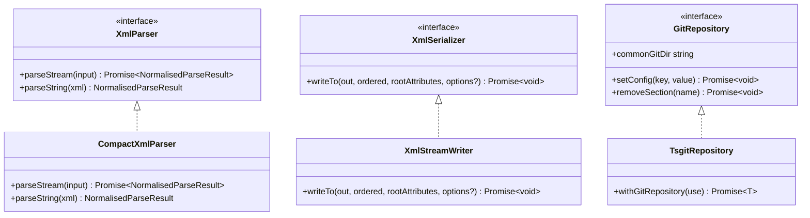
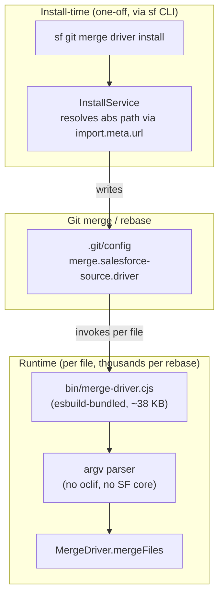
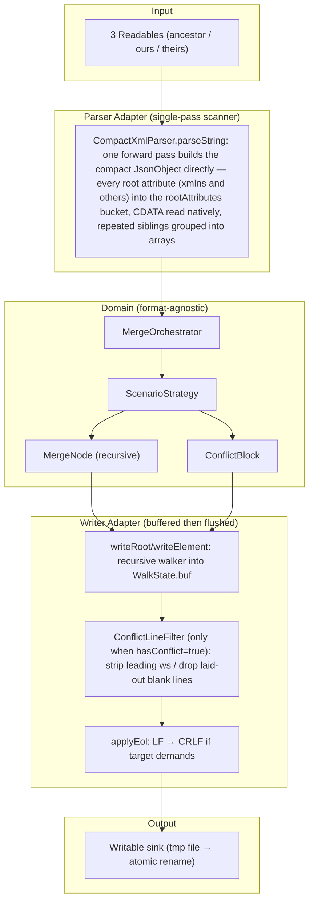
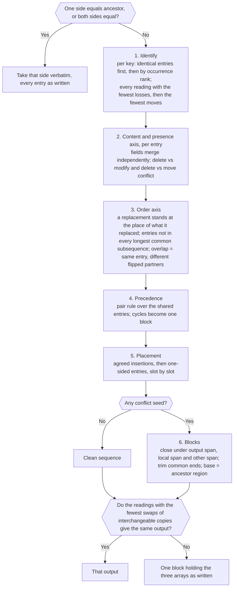

# Architecture Design Document

This document describes the software architecture of the Salesforce Git Merge Driver.

## Overview

The merge driver implements a three-way merge algorithm specifically designed for Salesforce metadata XML files. XML is parsed by a streaming reader into a compact JSON representation, the merge runs over that representation, and a recursive writer walks the merged tree into a single growable string buffer that is then written to the output sink. The writer is intentionally buffered rather than per-chunk streaming — at SF metadata sizes this is 30-45 % faster on serialize benches than the previous chunk-streaming approach (V8's cons-string optimisation + one final encode is cheaper than many small encoded writes).

## Design Patterns

### Strategy Pattern

The merge logic uses the **Strategy Pattern** to handle different merge scenarios. Each scenario (based on which versions have content) has its own strategy implementation.



**Strategies:**
- `NoneStrategy` - No content in any source
- `LocalOnlyStrategy` - Only local has content
- `OtherOnlyStrategy` - Only other has content
- `AncestorOnlyStrategy` - Only ancestor has content (deleted in both)
- `LocalAndOtherStrategy` - Both added (no ancestor)
- `AncestorAndLocalStrategy` - Other deleted
- `AncestorAndOtherStrategy` - Local deleted
- `AllPresentStrategy` - Full three-way merge

### Composite Pattern

The merge nodes implement the **Composite Pattern** to handle different data structures uniformly.



**Node Types:**
- `TextMergeNode` - Handles one value merged whole: scalars, any element carrying XML attributes (e.g. `<help xsi:nil="true"/>`, parsed as `{ '@_xsi:nil': 'true', '#text': '' }`), a text of several parts (text beside a CDATA section or a comment, adjacent CDATA sections, adjacent comments), and any tag whose present sides differ in value kind (text against an element, an empty tag against an element, CDATA against a comment), compared structurally. The factory routes these trios here (`isSingleValueTrio`, `src/merger/nodes/valueKind.ts`), and so does each matched entry of a keyed array (`isWholeValueTrio` in `mergeEntryContent`, `src/merger/nodes/entryContent.ts`). See "An Element Carrying Attributes Merges as a Whole" and "Text and Elements Are Different Kinds of Value" under Known Limitations
- `TextArrayMergeNode` - Handles arrays of primitive values (e.g., `members` in package.xml). Copies of a value are interchangeable, so each value is merged by counts: every copy is kept unless the sides disagree on how many survive, in which case that value is one conflict block
- `KeyedArrayMergeNode` - Handles arrays of objects with key fields (e.g., `fieldPermissions` with `field` key). Ordered kinds go to `OrderedKeyedArrayMergeStrategy`, the others to `UnorderedKeyedArrayMergeStrategy`; both identify an entry by its key plus its occurrence among the entries of that key ("Key-Based Array Merging"). An array with no key extractor, or in which any side holds a keyless entry, is merged by the ordered strategy: a keyless entry is identified by its content (a signature of the entry), a keyed one keeps its key, and entries merge one by one instead of as a whole array
- `PropertyMergeNode` - Handles pure objects without key extractor (property-by-property merge). The presence of the element is decided first by `mergeElementPresence` (`src/merger/nodes/elementPresence.ts`, shared with the keyed strategies): an element only one side holds is taken as written, one deleted by a side while the other left it unchanged is gone, and one deleted by a side while the other changed it is one conflict block for the whole element. Only when both live sides hold it does the property-wise loop run. An ancestor that does not hold the element is passed as `undefined`, never as a stand-in object: a plain `{}` would let a name such as `constructor` or `toString` resolve through `Object.prototype` and resurrect an element the side had deleted (parsed nodes are built with `Object.create(null)` for the same reason). A side holding text rather than child elements never reaches this node: the factory merges that tag as one value — see "Text and Elements Are Different Kinds of Value" under Known Limitations

### Factory Pattern

The `MergeNodeFactory` creates the appropriate node type based on the data structure:



The parts of a `__cdata` or `#xml__comment` key are one ordered value: a CDATA escape split over two sections (`]]]]><

Whether a keyed array is ordered is decided by its element name plus the shape of its entries (`MetadataService.isOrderedAttribute(attribute, sides)`).

## Core Components

### MergeOrchestrator

The central coordinator that:
1. Determines the merge scenario using the `getScenario()` function (in `MergeScenarioFactory.ts`)
2. Selects the appropriate strategy via `getScenarioStrategy()`
3. Builds the `MergeContext` and executes the strategy

Early termination when all inputs are equal lives in `AllPresentStrategy.execute()` (and `LocalAndOtherStrategy.execute()`) via `jsonEqual` fast-paths — see section "Early Termination Optimization" below.

```typescript
class MergeOrchestrator {
  constructor(config, nodeFactory?, contestedTagOrder?)
  merge(ancestor, local, other, rootKey?): MergeResult
}
```

### MergeContext

Immutable context object passed to strategies:

```typescript
interface MergeContext {
  readonly config: MergeConfig
  // `| undefined` preserves the "key not present on this side" distinction
  // from JsonValue null so strategies can branch on existence separately.
  readonly ancestor: JsonValue | undefined
  readonly local: JsonValue | undefined
  readonly other: JsonValue | undefined
  readonly nodeFactory: MergeNodeFactory
  readonly rootKey: RootKeyInfo | undefined
  // How the child tags of this element are ordered when the sides contest it
  readonly contestedTagOrder: ContestedTagOrder
  // Shared by every element this context's orchestrator merges
  readonly tagOrders: TagOrderCache
}
```

### MergeScenario

Enum representing the 8 possible scenarios based on content presence:

| Scenario | Ancestor | Local | Other | Value (bitmask) |
|----------|----------|-------|-------|-----------------|
| NONE | - | - | - | 0 (000) |
| OTHER_ONLY | - | - | ✓ | 1 (001) |
| LOCAL_ONLY | - | ✓ | - | 2 (010) |
| LOCAL_AND_OTHER | - | ✓ | ✓ | 3 (011) |
| ANCESTOR_ONLY | ✓ | - | - | 4 (100) |
| ANCESTOR_AND_OTHER | ✓ | - | ✓ | 5 (101) |
| ANCESTOR_AND_LOCAL | ✓ | ✓ | - | 6 (110) |
| ALL | ✓ | ✓ | ✓ | 7 (111) |

### Engine-Wide Doctrines

Every merge node applies the same rules; the kinds differ in what an element is and in whether order is an axis.

- **Identity.** An entry is its key plus its occurrence among the entries of that key (identical entries are matched first, then by occurrence), on every array kind. A text value is its type and value plus its occurrence (`1` and `"1"` differ). Two entries of one key are never collapsed to one.
- **Compatible changes merge, overlapping changes conflict in the smallest block.** Keys, values, fields and elements are decided independently; only the one that disagrees is a block.
- **A side that changed nothing defers.** When a side equals the ancestor, or both sides are equal, that key, value or element is taken as written, copies included.
- **Fields merge independently.** An entry present on both sides merges field by field, in keyed arrays of every kind, with a one-field block when two sides edit the same field.
- **Delete versus edit conflicts.** One side deleting an element the other changed is one block for the whole element, `<[] | ancestor | modified>` or its mirror: for an entry of a keyed array, a pure object, a whole file (see "Conflict Handling"), and in an ordered array a move or, at any level, a reorder of the child tags. A deletion against an unchanged element is a deletion.
- **No silent guess.** When the input admits several identity readings (which copy of a repeated key a side edited), the merge is clean only if every reading merges to the same entries; otherwise the copies of that key (or the counts of that value) are one block.
- **Role symmetry.** Swapping local and other gives the same output, with the sides of each block swapped.
- **Resolvable blocks.** An absent side of a block is the empty array, and each side taken alone is well-formed content of its place, so keeping either one gives a deployable file.

| Kind | Element | Order is an axis | Block |
|---|---|---|---|
| `UnorderedKeyedArrayMergeStrategy` | an entry | no (written sorted by key) | the copies of a key, or the entry, or one field |
| `OrderedKeyedArrayMergeStrategy` | an entry | yes | the smallest zdiff3 region (see "Deterministic Ordering Algorithm") |
| `TextArrayMergeNode` | a value | no (written sorted by value) | the copies of a value, repeated as many times as each side holds it |
| `PropertyMergeNode` | the element, then each property | no; the order of the child tags is merged apart from the properties ("Canonical (First-Seen) XML Tag Order") | the whole element, or one property |
| `TextMergeNode` | one value | no | the whole value |

A text array decides a value's copies by counts, since copies are interchangeable: each side keeps `min(side, ancestor)` copies, the survivors range over `[max(0, keptLocal + keptOther - ancestor), min(keptLocal, keptOther)]`, and the merge is clean only when that range is one number (`mergedCount`, `src/merger/nodes/TextArrayMergeNode.ts`); the output holds the survivors plus the larger number of copies one side added. Repeated keys of a keyed array enumerate their identity readings (`readings`, `src/merger/nodes/keyedReadings.ts`), uncapped.

### Conflict Handling

When conflicts cannot be auto-resolved, the merger produces `ConflictBlock` domain objects:

```typescript
interface ConflictBlock {
  readonly __conflict: true
  readonly local: JsonArray    // local version content
  readonly ancestor: JsonArray // ancestor version content
  readonly other: JsonArray    // other version content
}
```

The writer expands these into zdiff3-style conflict markers in the XML output:

```xml
<<<<<<< ours
    <field>localValue</field>
||||||| base
    <field>originalValue</field>
=======
    <field>remoteValue</field>
>>>>>>> theirs
```

When a conflict block occupies the whole document (one side deleted the file while the other edited it), each non-blank side renders its root element with the root attributes that side parsed with, `||||||| base` included: every side is a faithful, well-formed document, so keeping either one leaves a root that declares exactly what it declared. A side that deleted the file has no root to render. That conflict is decided before the body and the root attributes merge (`isDeleteVersusEdit`, `src/merger/fileDeletion.ts`): a side without a root against a side whose document, body or root attributes, differs from the ancestor's is a whole-file conflict, whatever the change is (an emptied root, a filled one, one more attribute, a text, CDATA or comment body). The order of attributes, on the root or on any nested tag, is no change here, as in every other merge (`sameContent` and `jsonIdenticalUpToAttributeOrder` read attributes as a set); the order of child tags is a change. A deletion against an unchanged file, or against another deletion, stays a deletion, and a file the ancestor did not hold is only added.

In a file that holds a conflict, a text line or attribute-value line, inside a side or not, whose first non-indent characters form a marker sequence (`=======`, `>>>>>>>`, `|||||||` at the configured size) is written with its first character as a numeric character reference (`&#61;======`), which XML reads as the same text, so the only marker lines left are the real ones. Only a line that starts an output line is escaped: the first line of a value that follows an opening tag or an `="` is left as written, so a one-line `=======` value is not rewritten (fixture `100-single-line-marker-value-in-conflict`). `<<<<<<<` needs no escape: text cannot hold a raw `<`. Comments and CDATA cannot hold character references, so a marker-like line in one of them is refused (see "Refused Input") whenever the merge has a conflict, inside a side or not. A comment never follows a marker on its line: after a conflict block it starts on a fresh indented line (fixture `99-comment-after-nested-conflict`). Output with no conflict is never touched (fixture `98-marker-like-text-line-in-conflict`). Several comments under one parent parse as a list and are written one `<!--item-->` each (fixture `101-two-comments-in-one-element`), where several CDATA sections are one text, written back as adjacent sections in order on one line, so the standard `]]]]><![CDATA[>` escape and any other split round-trip byte for byte.

Every `ConflictBlock` side is an array of wrapped elements, and an absent side is the empty array. The block is the smallest one that decides the disagreement, and its shape depends on what disagrees:

| Situation | Block |
|---|---|
| Two sides edit one field of an entry or object present on both | One-field block inside the entry, the other fields merged around it |
| One side deletes an element the other modified, reordered the child tags of (or, in an ordered array, moved) | One block for the whole element: `<[] \| [ancestor] \| [modified]>` or its mirror |
| Copies of one repeated key that the readings cannot settle | One block listing each side's copies of the key, as written |
| Copies of one text value whose counts the readings cannot settle | One block with the value repeated as many times as each side holds it |
| Overlapping changes in an ordered array | The smallest zdiff3-shaped block over entries, see principle 0 of "Deterministic Ordering Algorithm" |

Marker expansion happens inline as the writer walker visits each `ConflictBlock` — no separate post-processing pass. Every marker sits alone on its own line: whatever follows the closing marker (a close tag, a sibling) starts on a fresh indented line. A two-pass `ConflictLineFilter` (strip horizontal whitespace before a marker, drop the whitespace-only lines the writer lays out) keeps the byte layout identical to git's conventions; the filter runs only when the merger reports `hasConflict=true`. A line of a value (text, CDATA, comment or attribute value spanning several lines) is never dropped, blank or not: the writer records the offsets of those lines in `WalkState.valueLines` and the filter skips them (fixture `102-blank-lines-in-values-of-conflicted-file`).

### Ports & Adapters (Hexagonal Architecture)

The XML parsing and serialization are isolated behind port interfaces, keeping the merge domain free from library-specific format details. The parser reads from a `Readable`; the writer builds the serialized output into a single growable string buffer in one recursive walk, then emits it through `Writable.write` in one call (no-conflict path) or replays it through the conflict-line filter in 16 KiB windows (conflict path). The buffered approach is intentional — for SF metadata sizes (KB-MB) it beats per-chunk streaming by 30-45 % thanks to V8's cons-string optimisation.



- **`XmlParser` port** — Reads XML from a `Readable` (or a string), returns `NormalisedParseResult = { content, rootAttributes }`.
- **`XmlSerializer` port** — Writes the serialized document to a `Writable`: XML declaration, elements (open/close/cdata/comment), root attributes on the first top-level element, and inline conflict-block expansion. When the whole document is a single conflict block there is no first top-level element, so the root element of each non-blank side carries the root attributes instead. When the root attributes are contested, the root start tag is written as a conflict of its own (see "Root Attribute Merge Follows the Doctrines of Fields"). The optional `WriteOptions` carry the target `eol`, `hasConflict` (defaults to `true`; `false` lets callers skip the conflict-line filter when the merge produced no `ConflictBlock` — the common case), the `contested` start tags and the root attributes of each side. A line break inside a contested attribute value is written as `&#10;`, so no value line can stand alone between the markers and read as one.
- **`CompactXmlParser`** — Adapter with no third-party XML library. `parseStream` drains the bytes and `decodeXmlBytes` (`src/adapter/parser/decodeXmlBytes.ts`) decodes them with a fatal UTF-8 `TextDecoder` after checking the declared encoding and sniffing UTF-16, so a multi-byte character split across chunks is intact and any other encoding is refused. `scanDocument` (`src/adapter/parser/scanDocument.ts`) makes one forward pass over the source string, pushing an `ElementFrame` accumulator on each open tag and popping it into its parent on the matching close, building the compact JsonObject shape the merger and writer expect directly — no intermediate DOM, no separate normalise walk. `<![CDATA[…]]>` sections are read natively into `__cdata` keys; there is no sentinel rewrite. The fast path resolves attributes, closes, comments and CDATA inline; when it meets a construct its lexer can't disambiguate on its own (a stray quote in a tag name, attribute name, unquoted attribute value, skipped position or close-tag text; a comment shorter than `<!---->`; or a close tag at top level) it sets a `needsOracle` flag instead of guessing, and `assertBalancedTags` (`src/adapter/parser/balanceOracle.ts`) re-walks the document quote-aware to settle it; a scan failure runs the oracle first, so its balance-family message wins when both passes reject the input. Contract: **byte-exact on Salesforce-shaped XML, XML-correct elsewhere**. Measured with paired A/B runs against the previous adapter: 25 % (medium), 28 % (large) and 40 % (xl) faster on the parse phase, with 32 % lower peak RSS on the xl tier, at a near-identical bundle size now that the external parser dependency is gone.
- **`XmlStreamWriter`** — Single recursive walker (`writeRoot` → `writeElement` → `writeChildren`) that appends serialized XML directly to a mutable `WalkState.buf` string. No generators, no per-chunk object allocations, no `for...of` over generators. `getIndent` memoises the per-depth `\n + N×indent` prefix. The walker is sync; only `writeTo` is async, awaiting `out.write`'s drain signal once at the end (no-conflict path) or per 16 KiB filter window (conflict path). Child element tags and attributes within each node are emitted in **first-seen (source) order** — the insertion order of keys in the compact JSON object as set by the parser — rather than alphabetical order. Because `CompactXmlParser` preserves source tag order and `sf project retrieve` writes files in the Metadata API XSD `xs:sequence` order, the driver's output matches the canonical Salesforce order for retrieve-sourced files. The writer only emits the order it is given; the merge of the child-tag order is described in §6 below.
- **`GitRepository` port** — Exposes `commonGitDir` (absolute path to the repository's shared git directory), `setConfig(key, value)`, and `removeSection(name)`. Keeps `gitAttributesPath.ts`, `InstallService`, and `UninstallService` free of any git-library import; the port throws `NotAGitRepositoryError` when the caller is not inside a git working tree.
- **`TsgitRepository`** — The single file that imports `@scolladon/tsgit`, wired through `withGitRepository(use)`. Opens the repository with `hooks: false` and `command: false` so a hostile repository's `.git/hooks/*` scripts or a configured `[merge].driver` command can never execute during install/uninstall. `openRepository` itself succeeds even outside a repository, returning a synthetic layout, so a probe of `core.repositoryformatversion` (local scope) runs before anything reads the layout — that probe, not the open, is what proves the current directory is a real repository. The handle is disposed in a `finally`. The shared git dir is resolved with the vendor's own `commonDirOf(layout)` (from the `@scolladon/tsgit/primitives` subpath) rather than a hand-rolled `commonDir ?? gitDir`, so the linked-worktree semantics stay owned by the library. `GIT_DIR` and `GIT_COMMON_DIR` are read here and forwarded as explicit `gitDir` / `commonDir` options, because tsgit consults no environment variable of its own.

### Refused Input

Input the merge cannot round-trip is refused instead of rewritten: the driver throws, exits 1 and leaves ours untouched, as it does for any parse failure. The refusals are:

- Attributes: an attribute with no value (`<x flag>`, which would come back as `flag="null"`); an attribute whose name starts with a character the lexer would drop (`__proto__`, `1x`, `:x`, which would come back renamed); a stray character between attributes (`<a k="2" !k="9">`, which would overwrite `k`).
- Names: an element name that is empty or cannot start a name (`<=======>`), refused as an invalid element name, not as a malformed attribute.
- Document shape: a second top-level element; text, a CDATA section, a comment, a processing instruction or a DOCTYPE outside the single root element; a processing instruction or a `<!` declaration inside it (all of which would be dropped); a second XML declaration or one anywhere but the start of the document (position 0, or right after a byte order mark; whitespace around the root is accepted).
- Encoding: any side that is not UTF-8, meaning a declaration naming an encoding other than UTF-8 or US-ASCII, bytes that are not valid UTF-8, or UTF-16 (named in the message). Read as UTF-8 they would replace every non-ASCII byte and rewrite the declaration.
- Root: any side that renames the root element (`assertOneRootTag`, `src/merger/XmlMerger.ts`). The root tag is the metadata type, which Salesforce never renames, and a rename would merge into a second root or a side no marker can show. A side without a root has dropped the file and renames nothing.
- Writer: a comment or CDATA line that reads as a conflict marker, in a file that holds a conflict (see "Conflict Handling").

Only XML whitespace (space, tab, line feed, carriage return) is trimmed around text, CDATA and comment bodies. A no-break space, a Unicode separator or a byte order mark inside a value is content, which `String.prototype.trim` would strip. A byte order mark opening the file marks the encoding and is skipped.

## Binary Entry Point

Git invokes the merge driver for every metadata file conflict. To avoid loading the full oclif + `@salesforce/core` stack (~600 ms) on each invocation, a standalone binary is shipped alongside the oclif commands.

### Runtime Topology



### Invocation surfaces

The project exposes three entry points with distinct audiences and perf profiles:

| Surface | Audience | Performance | Notes |
|---|---|---|---|
| `sf git merge driver install` / `uninstall` | One-off setup per repo | Startup cost acceptable (runs once, then never again) | Resolves the binary path via `import.meta.url` and bakes it into `.git/config` so git invokes the binary directly — not `sf` — during merges. |
| `bin/merge-driver.cjs` directly | Git (per-file during merge/rebase) **and** scripting | ~37 ms cold start | Packaged with `"bin": { "sf-git-merge-driver": "./bin/merge-driver.cjs" }` in `package.json`; shebang `#!/usr/bin/env node` + mode 755. Scripting users resolve its path from the sf-installed plugin — see README "Advanced: direct binary invocation". |
| `sf git merge driver run` | **Deprecated** — scheduled for removal in the next major release | Slow (sf CLI + oclif + `@salesforce/core` stack) | Retained only for backward compatibility with `.git/config` entries generated by sf-git-merge-driver ≤ 1.5. Upgrading users are nudged toward `sf git merge driver install` by the in-README upgrade banner. |

Deprecation is encoded natively via oclif's command-level deprecation API
([command.d.ts `state` + `deprecationOptions`](https://github.com/oclif/core)):

- `static readonly state = 'deprecated'` on `src/commands/git/merge/driver/run.ts`
  causes oclif to emit a `formatCommandDeprecationWarning` on every invocation
  and mark the command deprecated in `--help` output.
- `static readonly deprecationOptions = { version, to }` supplies the target
  version and redirection so the warning is actionable, not just noise.
- The description in `messages/run.md` opens with `DEPRECATED` so `--help`
  reinforces the runtime banner.

### Build Pipeline

The binary is produced by esbuild from the compiled TypeScript:

```
src/**/*.ts → tsc → lib/**/*.js → esbuild (minify, treeshake, cjs) → bin/merge-driver.cjs (~38 KB, mode 755)
```

Key build choices:
- `keepNames: false` — saves ~22 KB; `@log('ClassName')` decorator passes names as string literals instead
- Shebang banner only. `module.enableCompileCache()` was measured as a no-op for a single-file bundle (see *Measured and rejected*)
- `__VERSION__` + `__BUNDLED__` injected via esbuild `--define` from `package.json`

Implementation: [tooling/build-bin.mjs](tooling/build-bin.mjs)

### Logging

The binary uses a pure-Node NDJSON logger ([LoggingService.ts](src/utils/LoggingService.ts)) that replaces `@salesforce/core` Logger across all command paths:

- Reads `SF_LOG_LEVEL` (fallback `SFDX_LOG_LEVEL`); default `warn` — zero I/O on the hot path
- Writes to `~/.sf/sf-YYYY-MM-DD.log` via `appendFileSync` (best-effort, failures swallowed)
- `SF_LOG_STDERR=true` mirrors to stderr
- Format: `{"level":N,"time":ms,"pid":N,"hostname":"...","name":"sf-git-merge-driver","msg":"..."}`

The `@log('ClassName')` decorator ([LoggingDecorator.ts](src/utils/LoggingDecorator.ts)) emits trace-level entry/exit logs for instrumented methods, including on async rejection and sync throw.

When the resolved log threshold at module init is above `trace` (the usual case — default is `warn`), the decorator installs **no wrapper at all**: the descriptor is left untouched, so decorated methods fall through unchanged with no closure, tagged-template, or async-detection cost per call. The short-circuit is evaluated exactly once per process via `isLevelEnabled(LOG_LEVELS.trace)`.

### Deep Equality

Element comparison uses a custom iterative `jsonEqual` ([jsonEqual.ts](src/utils/jsonEqual.ts)) instead of `fast-equals`. Stack-safe via explicit work stack; key-order-independent for objects, order-significant for arrays. A fast path that takes a whole side as written (`takeAgreedSide`, `takeWholeSide`, `keptByAllStatus`, `insertedStatus`) uses `jsonIdentical`, which also compares the order of an object's keys: entries that differ in tag order alone go through the child-tag order merge, so a cycle among their orders conflicts and a one-sided reorder is kept.

## Data Flow

`MergeDriver.mergeFiles` opens three `Readable`s on ancestor/ours/theirs, parses them in parallel, merges in memory, then streams the result through `XmlStreamWriter` into a temp file that is atomically renamed over `ours` on success. The line endings of the output come from the first of ours, theirs and ancestor that holds bytes (`peekDocumentEol`), so a file added by theirs over a deleted ours keeps its CRLF.



### Measured and rejected

- **Buffered `readFile`/`writeFile` instead of streams in `MergeDriver`.**
  Paired against the stream path: −0.1 ms (small fixture) to −1.7 ms (xl
  fixture), under 1% of end-to-end time. Rejected; the stream path stays.
- **A two-file compile-cache loader.** `module.enableCompileCache()` never
  populates its cache in the single-file bundle — a `mkdir` per run, zero
  entries, `Clear deserialized cache.` on stderr. A two-file loader that
  does let the cache hit measured −0.9..−1.4%, paired, under 1 ms. Not
  worth a second shipped file; the banner was removed.
- **`for…in` and lazy getters in the merge phase.** `for…in` traversal of
  the null-prototype parsed nodes in `isPresent` and `jsonEqual` measured
  slower than `Object.keys`, so both keep their current form. Lazy
  parameter getters in `TextMergeStrategy` bought nothing, because
  `AllPresentStrategy` — the dominant scenario — reads every field
  regardless.

## Key Design Decisions

### 1. Compact JSON Intermediate Representation

XML is converted to a compact JSON format for easier manipulation. The domain operates on plain JSON objects without knowledge of any XML parser library's conventions:
- Scalars are plain values: `{ field: "value" }`
- Nested elements are child objects: `{ parent: { child: "value" } }`
- Root attributes — the namespace declarations and any other, such as `xsi:schemaLocation` — are extracted by the parser adapter into a dedicated bucket (`rootAttributes`), not left on the root element, so the property-by-property merge never writes one back as a `<@_…>` child element
- The writer adapter walks the compact tree directly — splitting attributes (`@_`-prefixed keys) from children, expanding `ConflictBlock` objects inline into text markers, and appending bytes to a single growable buffer without materialising an intermediate ordered representation or generator chunk objects

### 2. Key-Based Array Merging

Salesforce metadata arrays (like `fieldPermissions`) use semantic keys rather than position-based merging. The driver identifies key fields from metadata configuration to match elements across versions.

An entry's identity is its key plus its occurrence among the entries of that key, on every array kind. Identical entries are matched first, then the rest by occurrence. A key the sides agree on, or that only one side changed, is taken as written, every copy kept. A key whose copies cannot be told apart is merged only if every identity reading merges to the same entries; otherwise the copies of that key are one block. Two entries of one key are never collapsed to the last one.

#### Shared element names across schemas

Salesforce reuses the same XML element name across unrelated parent schemas with **different key fields**. The `picklistValues` extractor in `MetadataService.ts` is the canonical example — it must support both schemas with a prefer-then-fallback pattern:

| Element | Parent schema | Key field |
|---|---|---|
| `picklistValues` | `CustomObjectTranslation.fields[]` | `masterLabel` |
| `picklistValues` | `RecordType` | `picklist` |
| `sections` | `Translations` | `name` |
| `sections` | `CustomObjectTranslation` | `section` |
| `values` | `RecordType.picklistValues[]` | `fullName` (ordered) |
| `values` | `CustomMetadata` | `field` (unordered) |
| `value` | `CustomField.valueSet…` | `fullName` |
| `value` | `Translations…inputParameters` | none (single element, matched by the lone-entry key) |
| `value` | `CustomMetadata.values[]` | none (an `xsi:type`/`xsi:nil` leaf merged as one value by `TextMergeNode`) |
| `loginFlows` | `Profile` | `friendlyName` |

The convention for resolving the ambiguity is to read each candidate property via `getPropertyValue`, which returns `undefined` for an absent or object-shaped field, and pick the first defined value with the `firstPresentKey` helper (`getPicklistValuesKey`, `getValuesKey`). Composite extractors return `undefined` only when no part is present. **Failing to do this leaves every entry under the wrong-schema document without a key**: the keyless fail-safe below then merges them as one ordered list under a single key instead of matching them by key. New extractors that share an element name with an existing schema must follow the same prefer-then-fallback shape.

**Keyless fail-safe.** `toSideKeys` (`src/merger/nodes/KeyedArrayIndex.ts`) yields keys only when every entry of a side has one; otherwise `KeyedArrayMergeNode` routes the array to the ordered strategy, where a keyless entry's identity is its content signature and a keyed one is namespaced by its key (a real key spelled `undefined` is an ordinary key). The same routing applies to an array whose element name has no key extractor. Editing a keyless entry, lone or not, is removing the old content and adding the new; identical entries match first, edits to different entries merge, and only overlapping edits conflict, in the smallest block. The fail-safe is a safety net, not a substitute for the right extractor.

### 3. Early Termination Optimization

When all three inputs are deeply equal, the merge returns immediately without traversing the structure. This significantly improves performance for unchanged files.

The early result returns the raw parsed value rather than the per-element wrapper shape the rest of the pipeline emits. The parser groups repeated siblings under one key (`{tag: [entry1, entry2]}`), so `buildEarlyResult` (`src/types/mergeResult.ts`) expands a single such grouped key into one wrapper per entry (`[{tag: entry1}, {tag: entry2}]`). Without this the writer would treat the array as a single element's body and collapse the repeats into one element — the failure mode for an element whose only child is a repeated keyed array (e.g. `CustomLabels` → `<labels>`), pinned by fixture `46-noop-single-keyed-array`.

### 4. Immutable Context

The `MergeContext` is immutable, ensuring strategies cannot accidentally modify shared state.

### 5. Configurable Conflict Markers

Conflict marker size and labels are configurable via Git's standard parameters (`-L`, `-S`, `-X`, `-Y` flags), allowing integration with existing Git workflows.

### 6. Canonical (First-Seen) XML Tag Order

Within every serialized node, child element tags and root attributes are emitted in **first-seen input order** — the order they appeared in the source XML — not alphabetical order. Alphabetical order enters only among the keys ready at once in the merge's topological sort (below) — the genuinely unordered ones; every tag whose position any side determines outright keeps its first-seen position regardless. This is established at two points in the pipeline:

- **Merge-time**: `mergePropertyOrder` (`src/merger/tagOrder/mergePropertyOrder.ts`) merges the three sides' key *sequences* in three steps. (1) Over the tags both live sides carry, `orderedComponents` (`src/merger/tagOrder/childTagRelation.ts`) applies the pair rule: sides that agree keep the order, where they disagree the side that inverted the ancestor wins, and a pair the ancestor does not hold whole (a tag both sides added at positions that disagree) is contested both ways. It returns the strongly connected components of that relation in order, found by counting rather than by search: pair by pair under 64 shared tags, by dominance sweeps (`src/merger/tagOrder/dominance.ts`, O(n log² n)) beyond. (2) `ChildTagBlocks` (`src/merger/tagOrder/childTagBlocks.ts`) grows every component of two or more tags to a fixed point: a block is one contiguous run in local and in other, so resolving it to a side gives that side verbatim, and the blocks and the other tags have a total order. It is a union-find with union by size where each pair of neighbours is joined once per axis, O(n α(n)); `propertyOrderConflict` turns a block into one conflict, each side as written, or, at root level (below), the block is written canonically. (3) The units and the tags only one side carries are placed by a Kahn topological sort over the consecutive pairs of each side (`src/merger/tagOrder/topologicalOrder.ts`): the next tag is the lowest rank among those ready, and a cycle among tags no block holds is broken at the one with the lowest residual indegree — never at a shared unit, which keeps its own order. Fast paths skip the relation: `sameSequence(local, other) && isSubsequence(ancestor, local)` returns `local`'s key sequence directly, and a side that kept the ancestor's sequence while the other side kept every ancestor tag returns the other side's sequence (`oneSidedOrder`; without the guard a tag the other side dropped would be lost, so `generalKeyOrder` decides then). The entries of one array mostly carry the same tags in the same orders, so `TagOrderCache` (`src/merger/tagOrder/tagOrderCache.ts`), owned by one `MergeOrchestrator` and carried in `MergeContext.tagOrders`, keeps the result by the three key sequences and the policy; it is bounded and never module state, and what it returns is only read.

  **What a block becomes depends on the level**, carried by `ContestedTagOrder` (`src/merger/tagOrder/contestedTagOrder.ts`) down `MergeContext.contestedTagOrder` to `mergePropertyOrder`. The direct children of the metadata root element (`<Profile>`, `<PermissionSet>`…) have a canonical order that the type decides, not the files: `fullName` first, then code point order (plain `<`, never `localeCompare`; verified on a dev org, 370 of 370 root elements in mdapi and source format). At root level (`ContestedTagOrder.CANONICAL`), `mergePropertyOrder` writes the tags a block would hold in its place in canonical order and returns no block, so each tag's content merges as usual and nothing conflicts. The canonical order only replaces what would have been a block: a one-sided reorder and disjoint pair swaps are kept as written, and it never overrides a side. Nested elements have no such rule (a Flow element uses schema order, `name, label, locationX…`; Translations `flowDefinitions` puts `flows` before `fullName`), so they keep the conflict (`ContestedTagOrder.CONFLICT`, the default). Three call sites merge a child-tag order: `JsonMerger` (the document's own tags, which is the root element name alone, so it never contests), `AbstractMergeStrategy.mergeChildren` (`src/merger/strategies/ScenarioStrategy.ts`; the root element's children when the `MergeOrchestrator` that `JsonMerger` builds runs it with `CANONICAL`, and the children of an entry of a keyed array, which come from an orchestrator with the default `CONFLICT`), and `PropertyMergeNode` (a property-wise object, always nested, so always `CONFLICT`). Nested elements reached through a node never inherit the root level's policy: each node builds its own orchestrator.
- **Write-time**: all three sort sites in `XmlStreamWriter` (`writeRoot`, `writeChildren`, `splitAttrsAndChildren`) preserve object key insertion order as returned by `Object.keys`, rather than calling `.sort()`.

Because `CompactXmlParser` preserves the source tag order (`ElementFrame.addChild` groups each child into a `Map` keyed by tag name, in first-seen order; `ElementFrame.toCompact` emits keys as `[attrs…, grouped tags in first-seen order…, #text last]`), and `sf project retrieve` writes files in the Metadata API XSD `xs:sequence` order, "emit first-seen key order" equals "emit XSD sequence order" for retrieve-sourced files — with no schema table to maintain.

**Parsed nodes are null-prototype**, and that is a pipeline-wide contract, not a parser-local detail. `ElementFrame.toCompact` builds each compact node with `Object.create(null)` because tag names come straight from untrusted XML and `__proto__` is a syntactically valid one: on a normal `{}`, `out['__proto__'] = value` invokes the inherited setter and rewrites the node's prototype instead of storing a child. Two obligations fall on every consumer of a parsed node:

- `key in node` is an **own-key test** — but only for parsed nodes. Objects the driver builds itself (the parser's `content` wrapper, constant tables such as `METADATA_KEY_EXTRACTORS` and `LEVELS`) still inherit from `Object.prototype`, so a key named `constructor`, `toString` or `__proto__` answers `true` there. Those lookups use `Object.hasOwn`.
- `String(node)` **throws** rather than coercing, because there is no inherited `toString`. Values that may be object-shaped are coerced through the local helpers in `MetadataService.getPropertyValue` (which reports the field as absent (`undefined`), so an unusable key field is filtered out) and `TextArrayMergeNode.toComparable` (which yields `JSON.stringify`, so distinct items stay distinguishable for sorting). The two differ deliberately: one needs the value to disappear, the other needs it to stay distinct.

Which value wins a merge never depends on tag order, but a contradiction between the sides' child-tag orders can conflict (nested elements) or settle in canonical order (children of the root element), as above. Determinism rests on two sources of order: `Object.keys` insertion order, which the parser already guarantees, and the tie-break's code-unit sort — bare `Array.prototype.sort()`, never `localeCompare` or `Intl.Collator` — so merged bytes never depend on the host machine's locale or ICU data (text-array values are sorted by one fixed `Intl.Collator('en')`, never the machine's locale). The "Deterministic Ordering Algorithm" section below is a separate axis: it governs the order of **array elements** (repeated same-name siblings) in ordered metadata types such as `GlobalValueSet`, and is orthogonal to within-node tag sequence. Unlike the tag tie-break, no sort and no tie-break ever decides the order of array elements: an order nothing determines is a conflict.

Five further properties of the tag order are worth stating explicitly:

- **Role symmetry.** `mergePropertyOrder(ancestor, local, other)` always equals `mergePropertyOrder(ancestor, other, local)`, so a `git merge` and the `git rebase` that swaps the same two branches produce identical layout. This is what the lexicographic tie-break buys — a rank keyed on argument position could not make this guarantee. Ordered arrays hold role symmetry without any tie-break: `merge(a, l, o)` and `merge(a, o, l)` emit the same array with the conflict sides swapped, because no step of the ordered pipeline compares key names.
- **Agreement with `diff3`.** Where git's own three-way merge raises a conflict on incompatible tag insertions — two sides inserting the same new tags in opposite relative order, or one tag at two places — this driver conflicts too in a nested element: as for ordered arrays (C6), a tag both sides add at positions that disagree is a block spanning the tags between its two places, each side verbatim (fixture `91-nested-child-tag-added-at-two-positions`). Among the children of the root element the same case merges clean in canonical order, because the type decides what the files do not (fixtures `49-permissionset-incompatible-group-order`, `50-permissionset-incompatible-group-order-swapped` and `89-profile-child-tag-added-at-two-positions`); that is a deliberate difference from `diff3`.
- **A reorder is a change.** When one side deletes an entry and the other only reorders that entry's child tags, the merge conflicts as delete versus modify does: the unchanged test of a deletion (`sameContent`, `deletedBySideStatus`) compares the order of an element's child tags too (fixture `93-delete-entry-vs-reorder-its-child-tags`).
- **Reorders are carried over.** A reorder one side made is kept (the other side's ancestor order has no say on a pair it did not invert), reorders on different pairs both hold, and only a cycle among the pairwise orders (`abc / bac / acb`) is contested: it conflicts as one smallest block in a nested element (fixtures `90-nested-child-tag-order-cycle`, `91-nested-child-tag-added-at-two-positions`, and `92-nested-child-tag-cycle-equal-content-keyed-entry` for a keyed entry whose content is equal on every side) and settles in canonical order among the children of the root element (fixture `88-profile-child-tag-order-cycle`).
- **The rank tie-break does not recover XSD order for concurrently-introduced tags.** When two sides introduce different new tags at the identical anchor, no input constrains their relative order, so the rank decides. For `Profile` and `PermissionSet` the canonical Metadata API top-level group order happens to be alphabetical, so the rank agrees with it; for types whose canonical order is not alphabetical (`fullName` first, as in `38-canonical-order-merge-name-label` → `fullName, name, label`, or `39-canonical-order-merge-criteria-items` → `fullName, active, criteriaItems`), the rank may disagree with the XSD sequence in that specific tie case. Recovering the XSD order there would require a schema table the driver deliberately does not maintain.
- **The `#text` residual, a known bounded limitation.** Where a tag key is left mutually unordered with `#text` — mixed content, where one side contributes an element the text-bearing side lacks — `#text` sorts ahead of every element name (`#` is U+0023, the lowest code unit any tag or attribute name can start with) and is emitted before that tied element. *Why it is bounded*: real Salesforce metadata has no mixed content — Metadata API elements contain either child elements or text, never both — and the repo's mixed-content fixtures (`22-mixed-content`, `indent-05-elem-text`, `indent-06-text-elem`) are hand-written serializer/indentation pins, not org-sampled metadata, so the residual needs an input the driver's actual domain does not produce. *Why it is not a regression*: the shipped driver already exhibited this asymmetrically — text last in one ours/theirs direction and not in the other — and the tie-break makes the behaviour consistent across both directions rather than introducing it. *Why it is not fixed here*: the parser collapses every text run in a node into one trailing `#text` key before this function ever runs, so text position is already destroyed and any placement the ordering function chose would be arbitrary rather than merely different; the remedy, if mixed-content metadata ever appears, is a writer-side partition in `splitAttrsAndChildren` that hoists `{ '#text': … }` wrappers after the element children in both its object and array branches — built, measured, and deliberately not taken. Comments (`#xml__comment`) and CDATA (`__cdata`) are not affected the same way: their key position round-trips faithfully through the parser and is preserved in both directions (`19-btb-comments`, `11-comments`, `45-comment-positioning`).

## Deterministic Ordering Algorithm

For ordered metadata types (e.g., `GlobalValueSet`, `StandardValueSet`), and for any keyed array whose entries cannot be told apart by key, the driver merges the entries with one doctrine: changes that do not overlap apply, changes that overlap conflict in the smallest block. The unordered kinds apply the same doctrine without the order axis, and an entry's fields merge independently on every kind.

### Core Principles

0. **Disjoint changes merge; overlapping changes conflict in the smallest zdiff3 block.** An ordered array is a sequence of entries. An entry's identity is its key plus its occurrence rank among entries of that key (identical entries are matched first, then by rank; when a key's unmatched entries on one side outnumber the other side's and are not all identical, the array conflicts whole). Each side changes an entry on one or more axes: **presence** (inserted: absent from the ancestor; deleted: absent from the side), **content** (kept with a different value), **order** (kept, but not in every longest common subsequence between the ancestor's and the side's orders of the entries both live sides keep). A side **touches** an entry when it changes it on any axis. The **position** of an entry on a side is its two explicit neighbours — the nearest entries before and after it that the other side also holds — plus the inherited order against every other entry of that side. Two changes are **disjoint** when they touch different entries, or the same entry on different axes, and their positions are compatible: the union of the sides' assertions — a flipped pair asserted by the side that flipped it, explicit placements of inserted entries, inherited placements that no explicit relation contradicts — orders every pair of entries exactly one way. Everything disjoint applies: one-sided changes, agreed changes, one side's reorder beside the other side's edit of the same entry. A side that removes entries and inserts others between the same neighbours **replaces** them: its insertions take the removed entries' place, so replacements of different entries merge in ancestor order, whatever the other side did elsewhere; where the other side edited or moved a replaced entry, the insertions stay plain and only that entry conflicts. Changes **overlap** when the same entry is touched on the same axis differently (edited to different values; moved against different partners; inserted at different explicit positions), when different entries claim the same position (two one-sided insertions with no shared entry between them), or when the assertions form a cycle. Each overlap is one conflict block, the smallest zdiff3 shape: the entries unordered against the block or ordered between its members join it; local and other are shown as the contiguous slices they wrote, with the common leading and trailing entries outside the markers; the base is the ancestor's entries in that region, agreed deletions included. Forced exceptions: an entry is emitted once (a block shows it on each side that holds it); entries kept by all three sides merge element-wise before anything else; delete versus modify always conflicts, and so does delete versus move. **No silent guess**: when the input admits several readings — which ancestor entry a repeated-key entry is, where an inserted entry sits once its inherited order is contradicted — the merge is clean only if every reading merges clean to the same output; otherwise it conflicts. The only exception is a live side identical to the ancestor or to the other live side, which is copied as written.
1. **User decides** — never auto-resolve ambiguous ordering conflicts: no sort and no tie-break ever decides an order.
2. **Value-based comparison** — entries are compared by key and occurrence, never by position alone.
3. **Disjoint change detection** — an entry is on the order axis only when it is not in every longest common subsequence; entries in some minimal explanation of a reorder are unmoved, so non-overlapping reorderings merge automatically.
4. **Conflict on overlap** — the same entry touched on the same axis differently, two insertions claiming one position, or a cycle in the sides' assertions.
5. **Blocks are closed** — a block owns the entries lying between two of its members in the output, in local and in other, and touching blocks merge; so a conflict never splits an entry across two blocks.
6. **A side that changed nothing defers** — when one side's array equals the ancestor, the other side's array is taken verbatim; when both sides are equal, that array is taken verbatim, repeated keys included.
7. **Role symmetry** — swapping local and other yields the same array, and the same blocks with their local and other sides swapped. Nothing in the pipeline compares key names, so renaming every key everywhere renames the output the same way.

The doctrines are checked as fast-check laws over every array kind, not only as examples. The table lists the main ones:

| Doctrine | Law file | Laws |
|---|---|---|
| Compatible changes merge | `test/unit/merger/laws/compatibleChanges.laws.test.ts` | identical sides are clean and unchanged; one-sided and same-on-both-sides changes render as that change; disjoint keys merge clean and apply both; no key is lost or duplicated by a clean merge |
| Smallest zdiff3 block | `test/unit/merger/laws/smallestConflict.laws.test.ts` | a key untouched by every side is in no block; a block's live sides differ, one is not empty, each is a contiguous run of its written side, and entries agreed at its ends sit outside it |
| Smallest block, against git | `test/integration/OrderedZdiff3Shape.test.ts` | a block is never wider than the hunk of `git merge-file --zdiff3` for the same region, except where entry identity forces it; skipped when `git` is not on the `PATH` |
| No silent guess | `test/unit/merger/laws/noSilentGuess.laws.test.ts`, `test/unit/merger/nodes/ordered/readings.test.ts` | a clean merge is what every identity reading yields; the readings the rules allow are exactly the ones `identify` finds, checked against an independent enumerator (`test/utils/readingOracle.ts`) |
| Entry identity | `test/unit/merger/laws/identity.laws.test.ts` | each identity appears once, a block counting once; fields of one entry merge independently; relabelling every key relabels the output |
| Forced exceptions | `test/unit/merger/laws/smallestConflict.laws.test.ts` | delete versus modify conflicts and each resolution keeps its side, for keyed, ordered and property kinds, and for a whole element |
| Role symmetry | `test/unit/merger/laws/smallestConflict.laws.test.ts` | swapping local and other mirrors the merge |

The laws' entry generators write a field as text, as an empty element or as an element of its own, so two sides regularly hold one field as text and as an element. The generators and helpers are in `test/unit/merger/laws/arbitraries.ts`. Further suites in `test/unit/merger/laws/`:

| Law file | Laws |
|---|---|
| `deployability.laws.test.ts` | a clean merge parses with the same root and keeps the root attributes; each side a block resolves to is a deployable file and markers sit on their own lines; no identity appears more often than in the busier live side; children and fields keep the order the sides share; one side deleting the file against an edit leaves the edit's side deployable |
| `typeDriven.laws.test.ts` | permuting the entries of the three versions consistently leaves the merge unchanged; an entry is matched by key, keeps every edit and appears once |
| `rootAttributes.laws.test.ts` | root attributes: nothing contested merges clean; a contested attribute resolves to each side with the settled ones; swapping local and other mirrors the merge |
| `tagOrderShortcuts.laws.test.ts` | the shortcuts of the child-tag order merge and its cache answer what the general merge answers |
| `valueKind.laws.test.ts` | a value that changes kind merges to items a side held, conflict sides included |
| `valueKinds.exhaustive.test.ts` | every trio of a set of values at a tag and at the root body, through the whole pipeline, checked against what a side held |

Exhaustive tests enumerate the whole input space of a small alphabet instead of sampling it; the fast-check laws sample with a pinned seed.

### Algorithm Overview

`mergeOrderedArrays` (`src/merger/nodes/ordered/mergeOrdered.ts`) runs this pipeline once per identity reading and compares the outputs:



Identification enumerates readings only when some side repeats a key; an array with unique keys has one reading and costs nothing extra. A keyless array (no extractor, or any keyless entry) is routed here with content identities, so identity falls out of content plus occurrence: identical entries match first, and disjoint edits merge entry by entry.

### Merge Scenarios

Each row is pinned in `test/unit/merger/nodes/ordered/doctrine.test.ts`. Entries are letters, `*` and `+` mark different edits of an entry, `∅` is an absent side, and `<local|base|other>` is a conflict block.

| ID | Ancestor / local / other | Result | Behavior |
|----|----------|----------|----------|
| M10 | `ABCD / BACD / ABDC` | `B,A,D,C` | Disjoint swaps: local moves {A,B}, other moves {C,D} |
| M11 | `CB / BC / BC` | `B,C` | Same reorder on both sides: every entry kept, once |
| M12 | `AB / AB / XBA` | `X,B,A` | One side equals the ancestor: the other is taken verbatim |
| UC9 | `ABCD / BADC / BACD` | `B,A,D,C` | Both sides agree on A,B moving; C,D moved by one side |
| UC10 | `ABCD / AXYZD / AXWZD` | `A,X,<Y\|B,C\|W>,Z,D` | Agreed insertions X and Z; Y and W claim one position; base is the region |
| UC11 | `AB / AXB / BA` | `<A,X,B\|A,B\|B,A>` | Cycle A<X<B<A |
| B1 | `ABC / AXBC / ABXC` | `A,<X,B\|B\|B,X>,C` | X inserted at different explicit positions |
| B2 | `ABCD / BCAD / BACD` | `B,<C,A\|A,C\|A,C>,D` | A moved against different partners |
| B4-B6 | `ABCD / BACDX / ABCDY` | `B,A,C,D,<X\|∅\|Y>` | Different insertions at the same end position (also with two entries each) |
| UC14 | `AB / AA*B / ABX` | `A,A*,B,X` | A second copy of a key is a one-sided insertion |
| R1 | `AB / XB / AY` | `X,Y` | Each side replaces a different entry: the insertions keep their entries' places |
| R2 | `AB / AX / AYB` | `A,Y,X` | X replaces B; Y sits before B on the other side |
| R3 | `ABC / XBC / BCA` | `X,B,C,<∅\|A\|A>` | The replaced entry is moved by the other side: X is a plain insertion, A conflicts |
| R4 | `A / AX / XY` | `X,<∅\|A\|Y>` | An insertion both sides made does not bound the replacement |
| R5 | `AB / AP / PP` (keyless) | `P,P` | Among the readings, only those with the fewest swaps of interchangeable copies count |
| UC15 | `ABC / CA / C` | `C,<A\|A,B\|∅>` | A deleted by other and moved by local: delete vs move; B, deleted by both, joins the base |
| C4 | `ABC / BAC / ACB` | `<B,A,C\|A,B,C\|A,C,B>` | Divergent moves: the cycle reaches every entry, so the block is whole |
| C5 | `ABCD / AD / ABD` | `A,D` | Adjacent deletions are disjoint: clean |
| C6 | `AC / ABC / ACB` | `A,<B,C\|C\|C,B>` | B inserted at different explicit positions |
| C7 | `AB / BAX / ABY` | `B,A,<X\|∅\|Y>` | A swap beside two insertions at one position: only the insertions conflict |
| C10 | `ABCD / ACD / ABD` | `A,D` | Adjacent deletions are disjoint: clean |
| G9 | `ABC / AXBC / AC` | `A,X,C` | An insertion beside a deletion is disjoint |
| G12 | `KBC / K*BC / BCK` | `B,C,K*` | One side edits K, the other moves it: different axes, clean |
| G15 | `AB / A*B / AB+` | `A*,B+` | Edits of different entries |
| G19 | `ABC / A / XC*YA` | `X,<∅\|B,C\|C*>,Y,A` | Delete vs modify of C |
| O1 | `A{x,y}B / A{x*,y}B / A{x,y*}B` | `A{x*,y*},B` | Edits of different fields of one entry merge |

### Implementation

The modules of `src/merger/nodes/ordered/`, in pipeline order, with the two helpers shared with the unordered kinds:

| Module | Purpose |
|--------|---------|
| `orderedEntry.ts` (`OrderedEntry`, `LiveSide`, `positionOn`, `valueOn`) | One identity with its ancestor, local and other values and positions |
| `identity.ts` (`identify`) | Groups each side by key, builds the identity readings, keeps the no-loss readings first, then the fewest moves |
| `content.ts` (`entryStatuses`) | Per-entry status: clean, gone, presence conflict (delete vs modify, delete vs move), content conflict; fields merge through the orchestrator |
| `orderAxis.ts` (`notInEveryLis`, `possiblyMoved`, `isKeptByAll`) | Order axis: an entry is moved unless every longest common subsequence keeps it |
| `replacement.ts` (`orderingView`, `replacementRuns`, `phantomSwaps`) | Replacement runs and the ordering view where they stand at the place of what they replaced; contested runs; swaps of interchangeable copies |
| `agreedReplacement.ts` (`withAgreedReplacements`) | An insertion both sides made in place of different entries: one entry whose place is ambiguous; it conflicts only when a kept entry lies between the two places |
| `orderedContext.ts` (`buildOrderedContext`, `isExplicitNeighbour`) | Per-reading context: statuses, live sequences on the ordering view and as written, moved sets, shared neighbours |
| `precedence.ts` (`orderOverlaps`, `tournament`, `cycleMarks`) | Pair rule over the shared entries, overlap seeds, cycles as strongly connected groups |
| `placement.ts` (`placeAgreedInsertions`) | Spine of shared entries with the entries both sides inserted in their slots |
| `oneSidedPlacement.ts` (`placeOneSided`) | Slots for entries only one side holds, ordered by their inherited place where both sides have one; contradicted or shared slots become seeds |
| `conflictSeeds.ts` (`ConflictSeeds`, `UnionFind`, `NO_MARKS`) | The seeds and joins the earlier steps raise |
| `blockClosure.ts` (`BlockClosure`) | Grows seeds into blocks over the output, local and other spans |
| `blockBase.ts` (`attachDeletions`) | Attaches deleted entries to the block whose region they bracket |
| `blocks.ts` (`buildBlocks`) | Trims common ends, builds each block's slices and ancestor base |
| `mergeOrdered.ts` (`mergeOrderedArrays`, `mergeReading`) | Entry point: whole-side shortcut, one pass per reading, the readings with the fewest phantom swaps, reading comparison, whole-array conflict |
| `../keyedReadings.ts` (`groupByKey`, `matchings`, `readings`) | Identity readings of a repeated key, shared with the unordered strategy |
| `../elementPresence.ts` (`mergeElementPresence`) | Presence axis of one element: one-sided presence is verbatim, delete vs modify is one block, shared by keyed entries and pure objects |

`OrderedKeyedArrayMergeStrategy` ([OrderedKeyedArrayMergeStrategy.ts](src/merger/nodes/OrderedKeyedArrayMergeStrategy.ts)) is a thin adapter from the `KeyedArrayMergeStrategy` port to `mergeOrderedArrays`.

### Applicable Metadata Types

Ordered merging applies to metadata with position-significant arrays:

- `GlobalValueSet` → `customValue` (key: `fullName`)
- `StandardValueSet` → `standardValue` (key: `fullName`)
- `CustomField` → `valueSet.customValue` (key: `fullName`)
- `RecordType` → `picklistValues.values` (key: `fullName`)

CustomMetadata `values` shares the element name with `RecordType` but is excluded by entry shape (an entry with `field` and no `fullName`): it is merged by `field`, unordered.

## Known Limitations

### XML Comment Positioning

XML comments are not guaranteed to keep their exact position relative to sibling elements through a merge. The compact intermediate representation groups child elements by tag name (`ElementFrame.addChild` groups them into a `Map` keyed by tag), and comments are stored under a single `#xml__comment` key. This representation can express a comment's position **between distinct-tag siblings** (Map insertion order is preserved) but **not between same-tag siblings**: `<a>1</a><!--c--><a>2</a>` collapses to `{ a: ['1','2'], #xml__comment: 'c' }`, which loses the comment's position between the two `<a>` entries — the comment re-emits after both.

This is **cosmetic and low-impact in practice**: `sf project retrieve` strips comments from retrieved metadata, so the only comments affected are hand-added ones in a working copy. Preserving comment position in all cases would require re-representing the compact tree as an order-preserving list (touching the parser, writer, and every merge node) and would change byte output broadly — a breaking change deliberately deferred to a future release with a version bump (see also `test/fixtures/xml/19-btb-comments`). The current behavior is pinned by `test/fixtures/xml/45-comment-positioning` and the `comment positioning` regression tests in `test/integration/XmlMerger.test.ts` so any future change is deliberate.

### Root Attribute Merge Follows the Doctrines of Fields

The root element's attributes — the `xmlns*` declarations and any other, such as `xsi:schemaLocation` — are extracted into a separate `rootAttributes` bucket by the parser adapter and never enter the JSON `content` tree (see "Compact JSON Intermediate Representation" above), so they never go through `MergeOrchestrator`/`ScenarioStrategy`. `mergeRootAttributes` (`src/merger/rootAttributes.ts`) resolves them per attribute, as fields: a one-sided change is kept, the same change on both sides is kept once, and attributes the sides changed apart merge. Different changes of one attribute, or a deletion against an edit, are contested.

A marker cannot go inside a start tag (`xmlns="<<<<<<< ours..."` is not XML), so a contested attribute makes the root start tag the conflict, each side verbatim: `XmlMerger` hands the writer the attributes of each side (`RootAttributeSides`) and the writer puts the three start tags between the markers, the children following the closing marker. Every side carries the attributes the sides settled, next to its own value of the contested one, so keeping either side gives a well-formed file without losing a clean edit. Pinned by fixture `94-root-attribute-changed-differently`, `test/unit/merger/XmlMerger.rootAttributes.test.ts` and `test/unit/merger/laws/rootAttributes.laws.test.ts`.

Only a side that still has a root element gets a vote. `rootAttributesOf` makes a live side that dropped the whole file abstain: its empty bucket means "there is no root element to carry the attributes on", not "the xmlns was removed", so it borrows the ancestor's bucket and the surviving side's declaration is preserved instead of being resolved away. The ancestor is never substituted — a rootless ancestor is the "file added on both sides" case, where an empty bucket genuinely does mean the attribute did not exist before. A side that keeps its root and drops only the attribute still votes to remove it.

### An Element Carrying Attributes Merges as a Whole

An element that carries XML attributes is merged as one value, not child by child: `MergeNodeFactory` routes it to `TextMergeNode`, and the unordered keyed-array strategy does the same for each matched entry that carries attributes (the ordered strategy already merges entries whole). An attribute belongs to its element's open tag, and a property-by-property merge has nowhere to carry it: each `@_name` key would be written back as a child element of its own (`<@_xsi:nil>true</@_xsi:nil>`).

What changes is concurrent edits to *different* children of one such element. If ours changes `<readable>` and theirs changes `<editable>` in the same attributed entry, the result is a conflict with each side's complete element between the markers, where the same edits on an element without attributes merge cleanly. A change made by one side only, or the same change made by both, still resolves without a conflict.

This is acceptable for Salesforce metadata, which puts attributes only on leaf elements (e.g. `<description xsi:nil="true"/>`, `<value xsi:type="xsd:string">`). A leaf has no children to merge separately, and its attribute qualifies its value, so merging the two apart could pair `xsi:nil` with text, or an `xsi:type` with a value of another type. Root attributes are resolved separately, as described above. Two different values of one attribute of such an element conflict as the whole element, each side as written (fixture `95-nested-attribute-changed-differently`): a start-tag-only conflict, as the root element gets, would need the attributes merged apart from the children, which this single-value merge deliberately does not do. Pinned by fixtures `58-attribute-element-divergent-edits` and `95-nested-attribute-changed-differently`, and `test/integration/AttributedKeyedElementMerge.test.ts`.

### Text and Elements Are Different Kinds of Value

At any tag, the root element included, one classification, `valueKindOf` (`src/merger/nodes/valueKind.ts`), tells the kind of value a side holds:

| Kind | Meaning |
|---|---|
| absent | the tag is not there |
| empty | `<tag/>`, parsed to `''` |
| text | a string, number or boolean |
| CDATA only, comment only, CDATA and comment only | an object holding only those keys, one kind for each combination |
| several parts | an object holding only those keys where one holds an array: adjacent CDATA sections or adjacent comments, the parts of one value |
| text and CDATA, text and comment, text with both | an object holding `#text` beside those keys, one kind for each combination: text next to a comment or CDATA section is content, not a child tag |
| mixed | an object holding `#text` beside child tags or attributes |
| element | an object with child tags, with or without attributes, and no `#text` |
| repeated | an array |

Merged child by child, text would be read as an object, its characters iterated as tags and `String.prototype` read for a child named `toString`; a comment against a CDATA section would be crossed into a value no side held. So when the present sides are of more than one kind, or a side holds a text of several parts (mixed, text with CDATA or a comment, CDATA with a comment, adjacent CDATA sections or adjacent comments) even when all three share that kind, and none is repeated, `holdsOneValue` (`src/merger/nodes/valueKind.ts`) answers that the trio is one value, merged whole by `TextMergeNode`: two sides editing different parts of such a text would otherwise build a text neither held. `isWholeValueTrio` adds the element carrying attributes, and the keyed-array strategies, ordered or not, ask it of each matched entry (`mergeEntryContent`). `isSingleValueTrio` adds the all-scalar trio and is the question the factory asks of a tag. A one-sided change is kept, the same change on both sides is clean, and divergent changes conflict as the whole value, each side verbatim. An absent side is no kind, so an addition on one side merges as before. A repeated element (an array side) is not one value: it keeps the array routes, which merge it item by item, so a conflict never renders several entries as one element (`test/unit/merger/laws/valueKind.laws.test.ts`). `toJsonObjectOrEmpty` maps anything that is not an object to an empty one, so no scalar reaches per-child merging. `test/unit/merger/laws/valueKinds.exhaustive.test.ts` merges every trio of a set of values at a tag and at the root body through the whole pipeline, and checks the result against what a side held.

The root body goes through the same check (`JsonMerger`), with two differences. An emptied root (`<Profile/>`) is read as a file whose entries all went away and keeps merging entry by entry, so the kind is read with it as absent, while the whole-value merge gets the sides as they are and renders it as `<Profile/>`. A root body that is a scalar text on all three sides is one value too: there are no entries to merge. `JsonMerger.mergeRoot` and the node factory ask the same question, `isSingleValueTrio`. Content-key parts (`__cdata`, `#xml__comment`) are one value by their tag name alone (`isContentParts` in the factory).

For example, a `Layout` column that ours empties to `<layoutColumns/>` while theirs leaves it unchanged stays `<layoutColumns/>` (fixture `96-layout-emptied-column-kept-one-sided`); a `b` element replaced by text on one side and untouched on the other is the text (fixture `97-element-replaced-by-text-one-sided`). When theirs edits an item of the emptied column, the conflict shows ours as `<layoutColumns/>`, not as an empty side.
